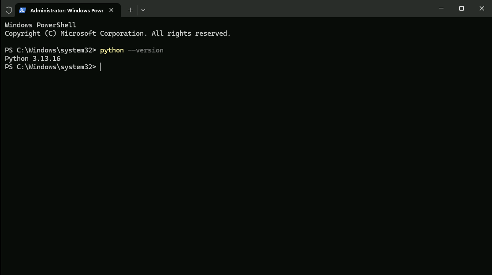
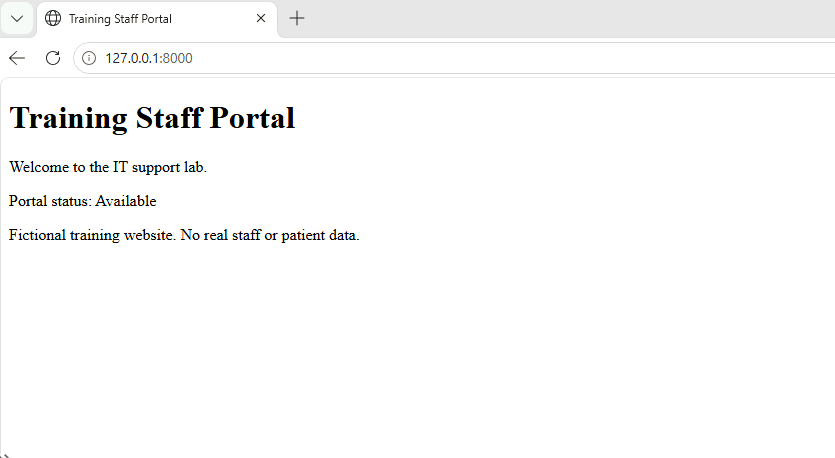
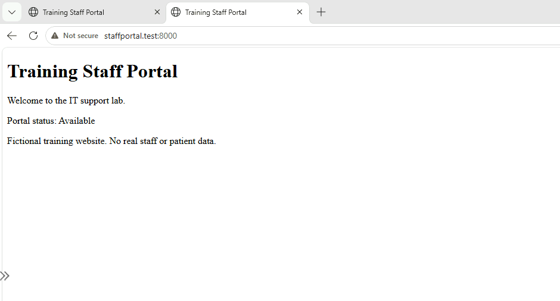
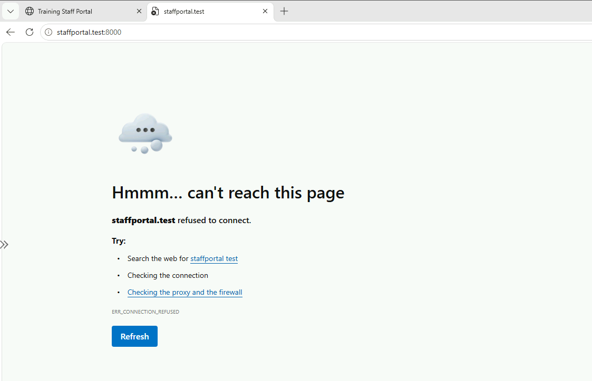
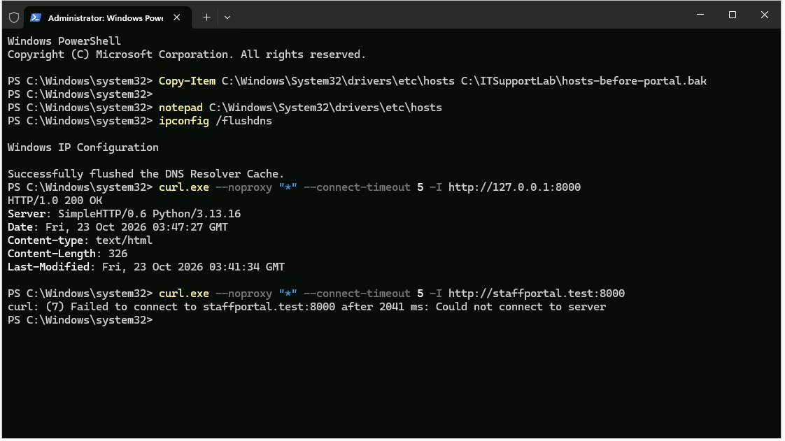
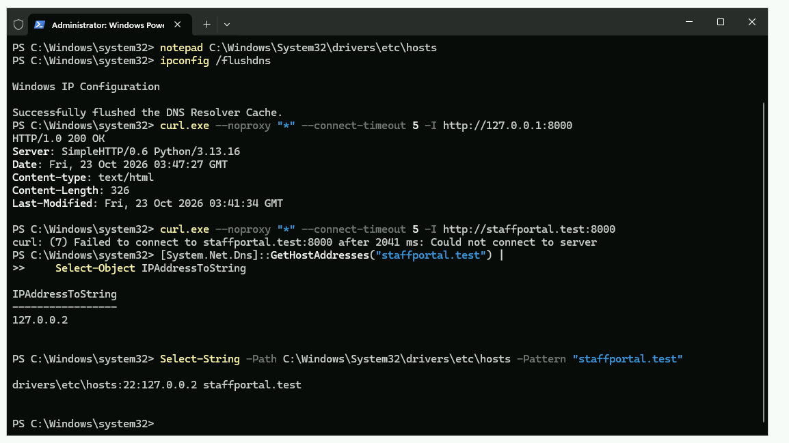
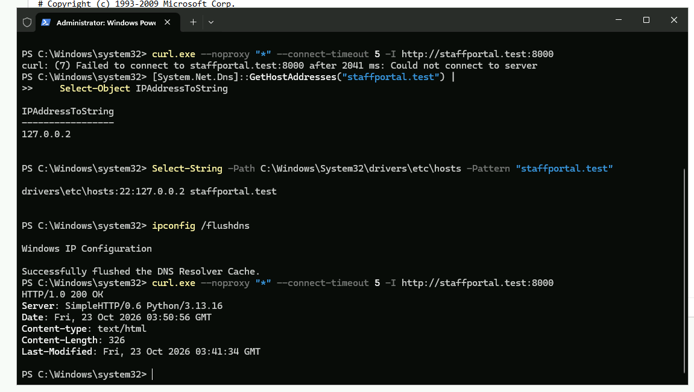
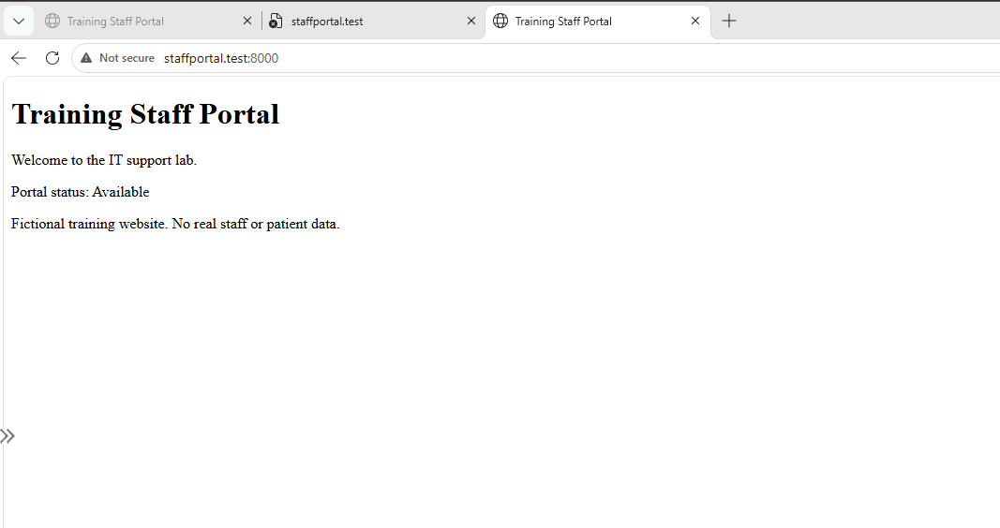

# Internal Portal Troubleshooting

**Author:** Justice Zulueta  
**Completed:** 23 October 2026  
**Environment:** Windows 11 Pro VM in Azure  
**Focus:** Level 1 troubleshooting, local name resolution and recovery verification

## Overview

I built a fictional staff portal, confirmed it worked by IP address and hostname, then deliberately changed its local hostname mapping to the wrong address. When access by name failed, I compared HTTP tests, inspected the resolved address and hosts file, corrected the entry, and verified recovery in both the terminal and browser.

The key finding was that the web server remained available while the hostname pointed somewhere else. This was a **local hosts-file mapping fault**, not a demonstrated DNS server outage or an internet outage.

## Scenario and scope

**Fictional support scenario:** A staff member cannot open an internal portal needed for their work. The analyst must determine whether the service is unavailable or the workstation is directing requests to the wrong address.

The user and business impact were simulated. Technical tests were performed on one VM, with a browser and web server on the same computer. No real staff data, patient data or clinical systems were involved. Multiple workstations, external DNS servers, authentication and production application workflows were outside scope.

## Environment

| Component | Configuration |
|---|---|
| Operating system | Windows 11 Pro, version 25H2, build 26200.9711 |
| Hosting | Existing Azure lab VM in East US 2 |
| VM size | Standard_D2als_v6 |
| Access | Existing Cyber Range Azure Bastion |
| Python | 3.13.16, installed for this project |
| Portal folder | `C:\ITSupportLab\Portal` |
| Server listener | `127.0.0.1:8000` |
| Training hostname | `staffportal.test` |
| Mapping file | `C:\Windows\System32\drivers\etc\hosts` |
| Backup | `C:\ITSupportLab\hosts-before-portal.bak` |

The server was bound to loopback, so no public website, additional VM or Azure network rule was required.



*Figure 1. Python was installed and its version confirmed in a new PowerShell window.*

## Troubleshooting workflow

### 1. Prepare the training website

Neither `python --version` nor `py --version` initially found an available command. I installed Python 3.13.16 from the official Python website, selected **Add python.exe to PATH**, opened a new PowerShell window, and verified the version.

I created `C:\ITSupportLab\Portal\index.html` containing a small fictional webpage. A copy of that page is included in [portal/index.html](portal/index.html).

I started the server with:

```powershell
python -m http.server 8000 --bind 127.0.0.1 --directory C:\ITSupportLab\Portal
```

I left the server running and used a second elevated PowerShell window for the hosts-file work and diagnostic commands.

### 2. Establish the working baseline

I opened `http://127.0.0.1:8000` inside the VM and confirmed the training page rendered.



*Figure 2. The expected webpage loads using the server's loopback IP address.*

Before editing the hosts file, I made a backup:

```powershell
Copy-Item C:\Windows\System32\drivers\etc\hosts C:\ITSupportLab\hosts-before-portal.bak
```

I opened the original file in Notepad from the elevated shell, preserved its existing contents, and added:

```text
127.0.0.1 staffportal.test
```

The same page then loaded at `http://staffportal.test:8000`.



*Figure 3. Hostname-based access works before fault injection.*

### 3. Introduce and reproduce the fault

I changed only the added mapping to:

```text
127.0.0.2 staffportal.test
```

I saved the file, ran `ipconfig /flushdns`, and opened the portal again. Edge displayed **ERR_CONNECTION_REFUSED**. The Python server remained running and bound specifically to `127.0.0.1`.



*Figure 4. The browser cannot connect through the deliberately incorrect hostname mapping.*

### 4. Separate service availability from hostname access

I ran the following HTTP checks:

```powershell
curl.exe --noproxy "*" --connect-timeout 5 -I http://127.0.0.1:8000
curl.exe --noproxy "*" --connect-timeout 5 -I http://staffportal.test:8000
```

The IP request returned **HTTP/1.0 200 OK**, while the hostname request failed with **curl error 7**. This narrowed the investigation toward the hostname's destination rather than a stopped server. It did not, by itself, prove the exact cause.



*Figure 5. Direct-IP access succeeds while hostname access fails.*

Command options used:

- `curl.exe` explicitly runs the executable rather than a PowerShell alias.
- `--noproxy "*"` bypasses proxies for these test requests, keeping the comparison direct.
- `--connect-timeout 5` bounds the connection attempt.
- `-I` requests HTTP headers. A successful result verifies the HTTP response; the separate browser check verifies the displayed page.

### 5. Inspect the resolved address and source mapping

```powershell
[System.Net.Dns]::GetHostAddresses("staffportal.test") |
    Select-Object IPAddressToString

Select-String -Path C:\Windows\System32\drivers\etc\hosts -Pattern "staffportal.test"
```

The resolver returned **127.0.0.2**, and the file inspection showed the same incorrect mapping. These results matched the injected fault and explained why the hostname did not reach the listener at `127.0.0.1`.



*Figure 6. Both the resolved destination and hosts-file entry show 127.0.0.2.*

Although the .NET class is named `Dns`, this test used the system name-resolution path. Its output is not evidence that an external DNS server returned the wrong address. I did not use a direct DNS-server query to diagnose this hosts-file fault.

### 6. Correct the mapping and verify recovery

I changed the added hosts entry back to `127.0.0.1 staffportal.test`, saved it, flushed the resolver cache, and repeated the hostname HTTP request:

```powershell
ipconfig /flushdns
curl.exe --noproxy "*" --connect-timeout 5 -I http://staffportal.test:8000
```

The request returned **HTTP/1.0 200 OK** without a server restart or network-rule change.



*Figure 7. A new hostname request succeeds after correcting the mapping.*

I then reopened the hostname URL in Edge and confirmed the expected content rendered.



*Figure 8. The page loads through its hostname after recovery.*

## Results

| Check | Observation |
|---|---|
| Initial page access by IP and hostname | Both succeeded |
| Browser access after incorrect mapping | ERR_CONNECTION_REFUSED |
| HTTP request to 127.0.0.1 during fault | 200 OK |
| HTTP request through hostname during fault | Connection failed |
| Resolved address and hosts entry during fault | Both showed 127.0.0.2 |
| Hostname HTTP request after correction | 200 OK |
| Browser after correction | Expected portal content displayed |

The correction restored the tested portal access. The page's static “Portal status: Available” text is demonstration content, not a health-monitoring system; the actual evidence is the HTTP response and successful browser rendering.

## Service desk documentation

- [Retrospective simulated incident ticket](docs/INC-002.md)
- [Portal access troubleshooting guide](docs/portal-access-guide.md)
- [One-page interview guide](docs/Internal_Portal_One_Page_Interview_Guide.pdf)

## What I learned

- A report that a website is unavailable does not establish that the server or internet is down.
- Comparing direct-IP and hostname requests can narrow the investigation.
- Hosts-file entries can affect local name resolution independently of external DNS records.
- Back up configuration before editing, change only the relevant entry, and verify the original user-facing task afterward.
- Cache flushing alone did not fix the wrong entry; the mapping had to be corrected.
- A real workplace investigation would also establish scope, urgency, permissions and ownership before changing configuration.

## Skills demonstrated

Windows troubleshooting, local hostname resolution, HTTP response testing, PowerShell, configuration backup, evidence collection and recovery documentation.

## Lab reuse and cleanup

The working mapping and portal can support a later application-outage exercise. To stop this foreground server, use **Ctrl+C** in its terminal. To retire this project's hostname, remove only the `staffportal.test` line and flush the resolver cache. Follow the Cyber Range's shutdown and deletion instructions when finished, and preserve evidence outside the VM. Cleanup was not part of the recorded recovery tests.
